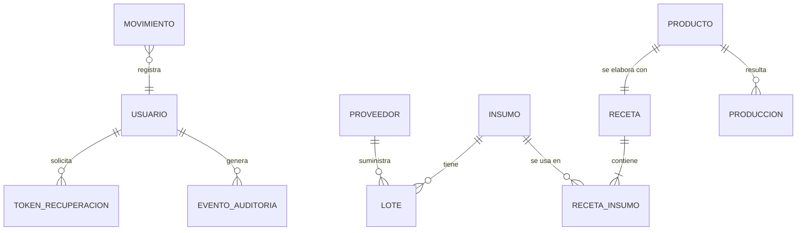

# BakerStock — Plan técnico v1.0

**Estado:** BORRADOR para la Puerta 2 · **Fecha:** 2026-11-13
**Responde al cómo.** Qué construir: `spec.md`. En qué orden: `tasks.md`.

## 1. Arquitectura

Una sola aplicación modular (ADR-001) en capas **sin `service`** (ADR-004):

```
Navegador ⇄ Controlador (MVC + Thymeleaf) ⇄ Repositorio (Spring Data JPA) ⇄ BD
                         │                          ▲
                         └── usa métodos del dominio (entidades con reglas)
Spring Security (filtro) protege las rutas por rol y emite eventos de auditoría
```

| Capa | Paquete (`com.bakerstock`) | Responsabilidad |
|------|----------------------------|-----------------|
| Dominio | `dominio` | Entidades JPA, enums y reglas (`Lote.estaVencido`, `Insumo.stockTotal`, `Insumo.stockUtilizable`) |
| Repositorio | `repositorio` | Interfaces Spring Data; consultas `@Query` (búsqueda, FEFO) |
| Web | `web` | Controladores por módulo, formularios con Bean Validation |
| Seguridad | `seguridad` | `SecurityConfig`, `UserDetailsService`, `@EventListener` de eventos de autenticación y autorización |
| Config | `config` | Perfiles, `DataSeeder` (solo `dev` y `cloud`) |

Las operaciones de varios pasos (Sprint 2) usan `@Transactional` en el método del controlador y bloqueo pesimista sobre los lotes (ADR-003).

## 2. Dependencias (Maven)

| Dependencia | Para qué | Requisito |
|-------------|----------|-----------|
| `spring-boot-starter-web` | MVC | todos |
| `spring-boot-starter-thymeleaf` | Vistas | todos |
| `thymeleaf-extras-springsecurity6` | `sec:authorize` en el menú | REQ-BAK-021 |
| `spring-boot-starter-security` | Autenticación y roles | REQ-BAK-015…021 |
| `spring-boot-starter-data-jpa` | Persistencia | todos |
| `spring-boot-starter-validation` | Validación de formularios | REQ-BAK-023, NFR-BAK-004 |
| `mysql-connector-j` (runtime) | MySQL en `dev` | ADR-002 |
| `h2` (runtime) | Perfil `cloud` y pruebas | ADR-005 |
| `spring-boot-starter-test`, `spring-security-test` | Pruebas | DoD |

Sin Lombok, sin biblioteca de correo y sin migraciones (se usa `ddl-auto=update` en `dev` y `cloud`).

## 3. Perfiles y configuración

| Perfil | Base de datos | Notas |
|--------|---------------|-------|
| `dev` | MySQL local (`bakerstock_db`) con `DB_URL`, `DB_USER`, `DB_PASSWORD` | `ddl-auto=update`; siembra de datos ficticios |
| `cloud` | H2 en memoria modo MySQL | Para Render; siembra de datos ficticios |
| `test` | H2 en memoria | Pruebas automáticas; sin siembra |

Propiedades comunes: `server.servlet.session.timeout=30m`, `spring.jpa.open-in-view=false`, zona horaria `America/Bogota`.

**DataSeeder** (`dev` y `cloud`): crea un usuario por rol con correos `@bakerstock.test`, algunos insumos y lotes de demostración (incluye un lote vencido y uno próximo a vencer). La contraseña viene de `BAKERSTOCK_SEED_PASSWORD`; si falta, se genera una aleatoria y se imprime **una sola vez** en el log.

## 4. Modelo de datos



### Tablas del Sprint 1

**usuario**: `id`, `nombre`, `correo` (UNIQUE, minúsculas), `contrasena_hash`, `rol` (ENUM ADMINISTRADOR, COMPRADOR, ALMACENISTA, PANADERO, CAJERO), `activo`, `creado_en`.

**token_recuperacion**: `id`, `usuario_id` (FK), `token_hash` (SHA-256 del token), `expira_en`, `usado`.

**insumo**: `id`, `nombre` (UNIQUE sin distinguir mayúsculas), `unidad_base` (ENUM G, ML, UNIDAD), `categoria` (ENUM, D-04), `stock_minimo` (DECIMAL(14,3), CHECK ≥ 0), `activo`.

**proveedor**: `id`, `nombre`, `nit` (UNIQUE), `telefono`, `correo`, `direccion`, `activo`.

**lote** (lectura en Sprint 1; se crea en la recepción del Sprint 2): `id`, `insumo_id` (FK), `proveedor_id` (FK, nullable), `numero_lote`, `cantidad_inicial`, `cantidad_actual` (CHECK ≥ 0), `costo_unitario`, `fecha_recepcion`, `fecha_vencimiento`.

**evento_auditoria**: `id`, `fecha_hora`, `usuario_correo` (texto; permite registrar intentos de correos que no existen), `accion` (ENUM: LOGIN_OK, LOGIN_FALLIDO, LOGOUT, ACCESO_DENEGADO, USUARIO_CREADO, USUARIO_DESACTIVADO, USUARIO_ACTIVADO, RECUPERACION_SOLICITADA, CONTRASENA_RESTABLECIDA, INSUMO_CREADO, PROVEEDOR_CREADO), `resultado` (OK, RECHAZADO), `detalle`. **Solo inserción** (sin `UPDATE`/`DELETE`).

### Tablas de Sprints 2 y 3 (resumen, se detallan al empezar cada sprint)

`orden_compra` + `orden_compra_linea`, `receta` + `receta_insumo`, `producto` (D-05), `produccion`, `movimiento` (inmutable; `tipo`, `motivo`, `cantidad`, `usuario`, `fecha_hora`, `lote_id`), `conteo_fisico`, `venta` + `venta_linea`.

## 5. Seguridad y rutas del Sprint 1

Autenticación por formulario (`/login`), sesión HTTP, CSRF activado, contraseñas BCrypt (coste por defecto), `UserDetailsService` sobre `UsuarioRepository`, rol como autoridad `ROLE_<ROL>`. Cuenta desactivada → `DisabledException`, tratada igual que credenciales inválidas en el mensaje.

| Ruta | Método | Roles | Requisito |
|------|--------|-------|-----------|
| `/login`, `/recuperar`, `/restablecer` | GET/POST | público | 015, 016, 018 |
| `/logout` | POST | autenticado | 017 |
| `/` | GET | autenticado | 021 |
| `/admin/usuarios` (+ `/nuevo`, `/{id}/desactivar`, `/{id}/activar`) | GET/POST | ADMINISTRADOR | 019, 020, 028 |
| `/proveedores` | GET | COMPRADOR, ADMINISTRADOR | 024 (D-03) |
| `/proveedores/nuevo` | GET/POST | COMPRADOR | 024 |
| `/insumos`, `/insumos/{id}` | GET | ADMINISTRADOR, COMPRADOR, ALMACENISTA, PANADERO | 025, 026 (D-02) |
| `/insumos/nuevo` | GET/POST | ALMACENISTA | 022, 023 |
| `/acceso-denegado` | GET | autenticado | 008 |

**Auditoría (sin capa service):** un `@EventListener` en `seguridad` escucha `AuthenticationSuccessEvent`, `AbstractAuthenticationFailureEvent`, `LogoutSuccessEvent` y `AuthorizationDeniedEvent` y escribe en `EventoAuditoriaRepository`. Los controladores guardan los eventos de negocio (`USUARIO_CREADO`, `INSUMO_CREADO`…) con el mismo repositorio.

## 6. Vistas (Thymeleaf + Bootstrap)

`fragmentos/menu.html` (menú con `sec:authorize`), `login.html`, `recuperar.html`, `restablecer.html`, `inicio.html`, `admin/usuarios/{lista,form}.html`, `proveedores/{lista,form}.html`, `insumos/{lista,detalle,form}.html`, `error/403.html`.

## 7. Estrategia de pruebas

| Tipo | Herramienta | Qué cubre |
|------|-------------|-----------|
| Dominio | JUnit 5 | `Lote.estaVencido`, `Insumo.stockTotal`, `Insumo.stockUtilizable` (AC-026.x) |
| Repositorio | `@DataJpaTest` (H2) | Búsqueda sin mayúsculas, unicidad, orden FEFO |
| Web y seguridad | `@SpringBootTest` + `MockMvc` + `@WithMockUser`/`spring-security-test` | AC-008, 015…028 |
| Configuración | `@SpringBootTest` | AC-N003.1 |

Cada prueba lleva el ID del criterio en `@DisplayName` (por ejemplo `@DisplayName("AC-016.1 contraseña incorrecta")`) y se registra en `docs/trazabilidad.md`.

## 8. Despliegue

`Dockerfile` en dos etapas (Maven build → JRE 21), perfil `cloud`, puerto desde `PORT`. Render (plan gratuito): la base H2 en memoria se reinicia en cada despliegue; los datos de demostración los repone el seeder (ADR-005).

## 9. Decisiones (ADR)

| ADR | Decisión | Estado |
|-----|----------|--------|
| ADR-001 | Aplicación única modular | Propuesta |
| ADR-002 | Base de datos relacional | Propuesta |
| ADR-003 | Stock no negativo con transacciones, bloqueo y restricción | Propuesta |
| ADR-004 | Sin capa service | Propuesta (D-07) |
| ADR-005 | Perfiles de base de datos y despliegue en Render | Propuesta (D-06) |

## 10. Riesgos del Sprint 1

| Riesgo | Mitigación |
|--------|------------|
| SpecFall | La especificación se cierra en 2 días; el esqueleto Spring y el login arrancan antes de la Puerta 2 en paralelo |
| Reglas de acceso inconsistentes | Una sola configuración de rutas en `SecurityConfig` y pruebas por rol (AC-008, AC-021) |
| Datos de demostración con contraseñas débiles | Contraseña por variable de entorno o aleatoria impresa una vez |
| Plazo: el Sprint 1 termina el 17 de noviembre | Calendario sugerido en `tasks.md`; los HU-06, 07 y 08 son los primeros candidatos a pasar al Sprint 2 si se acaba el tiempo (decisión con el PO en la Review) |
